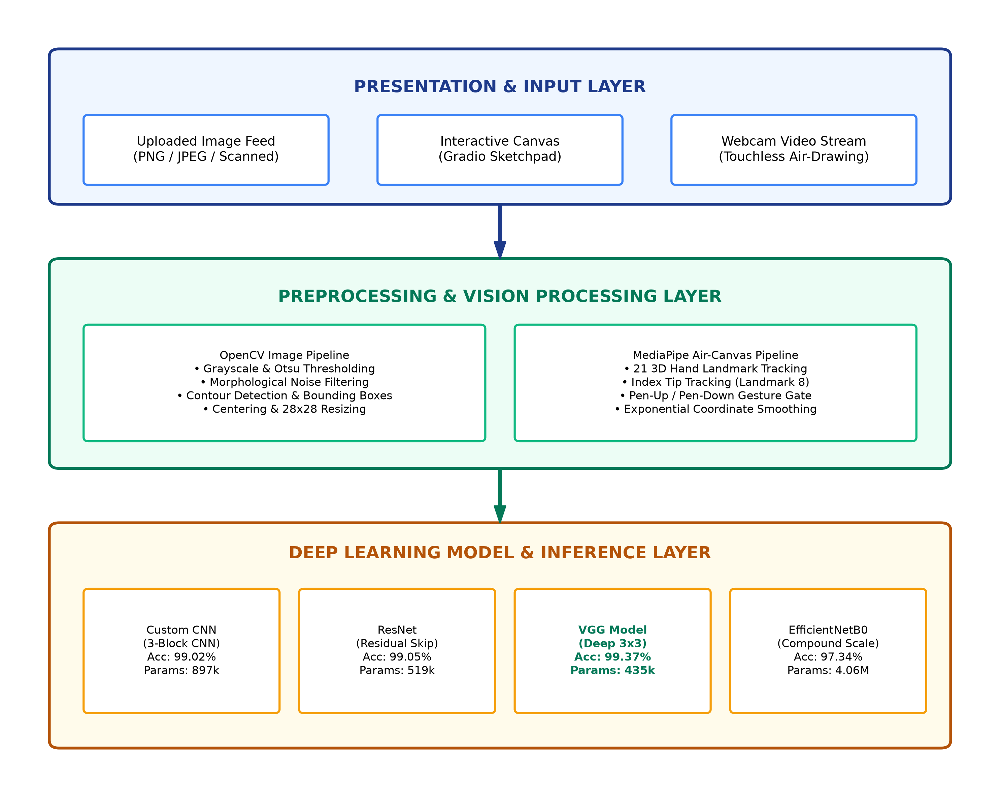
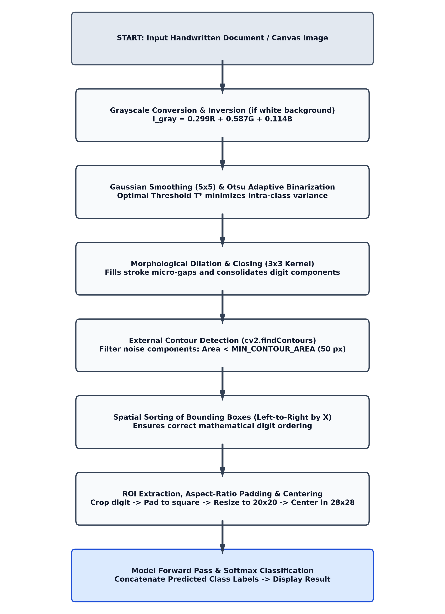
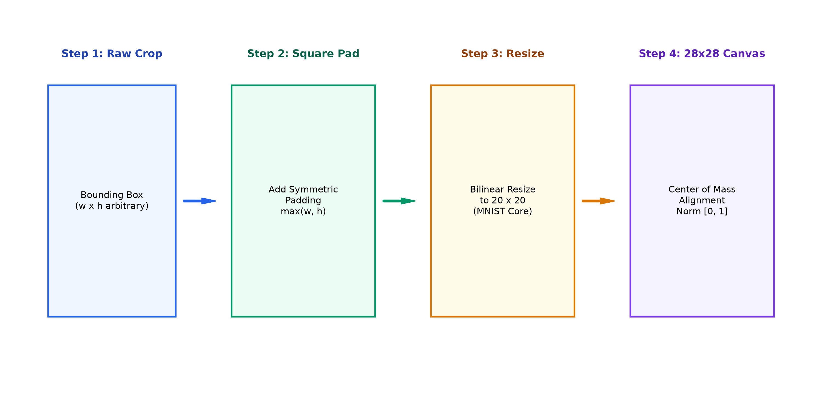
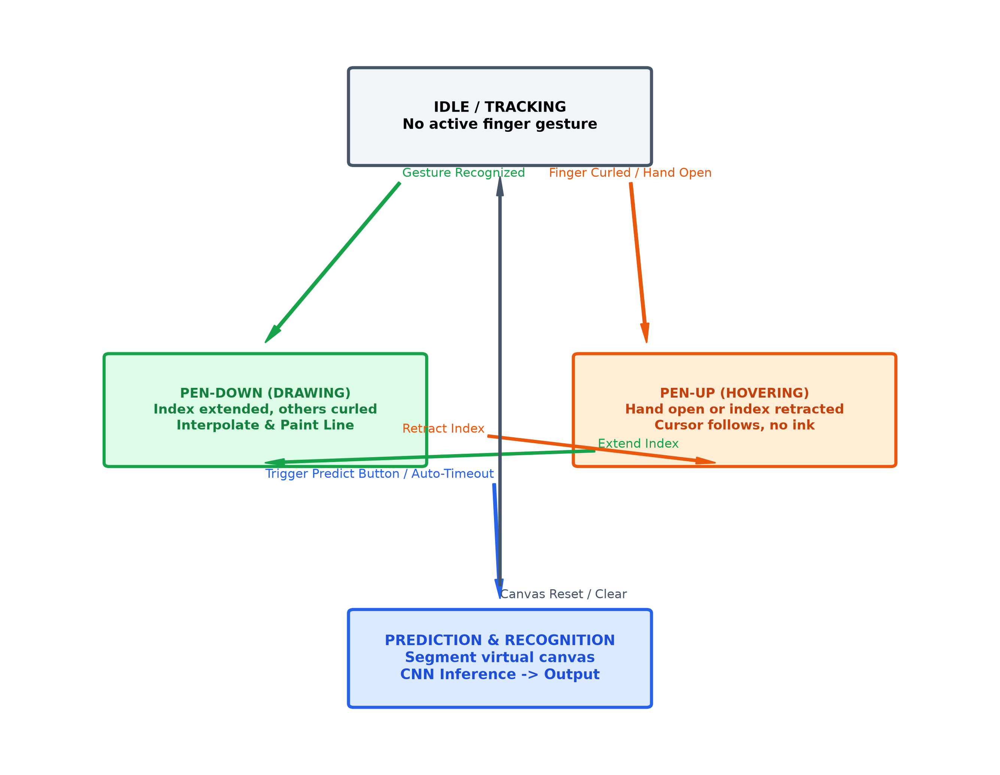
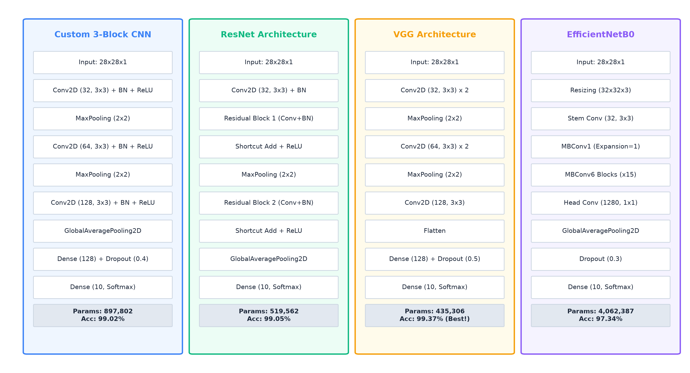
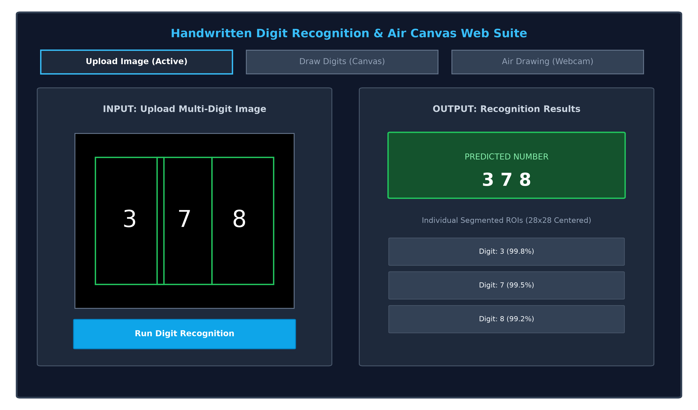
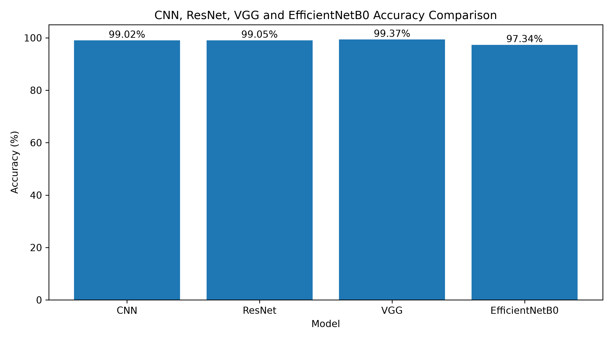
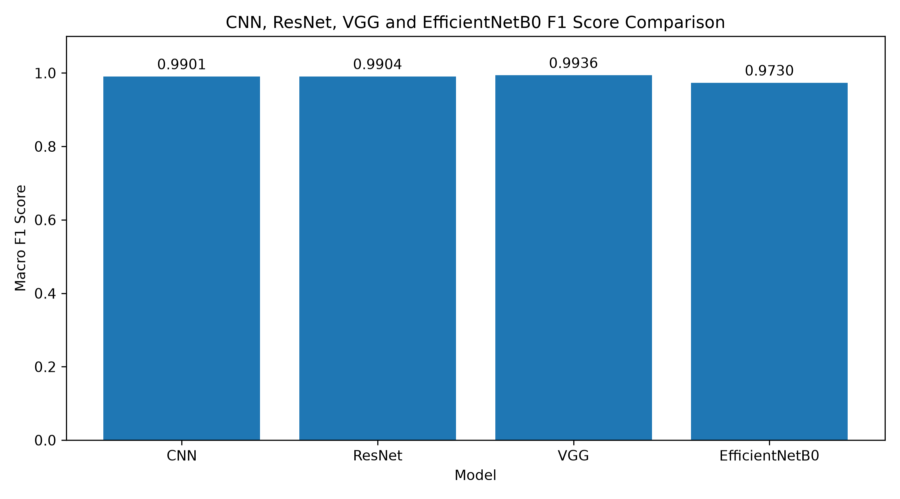
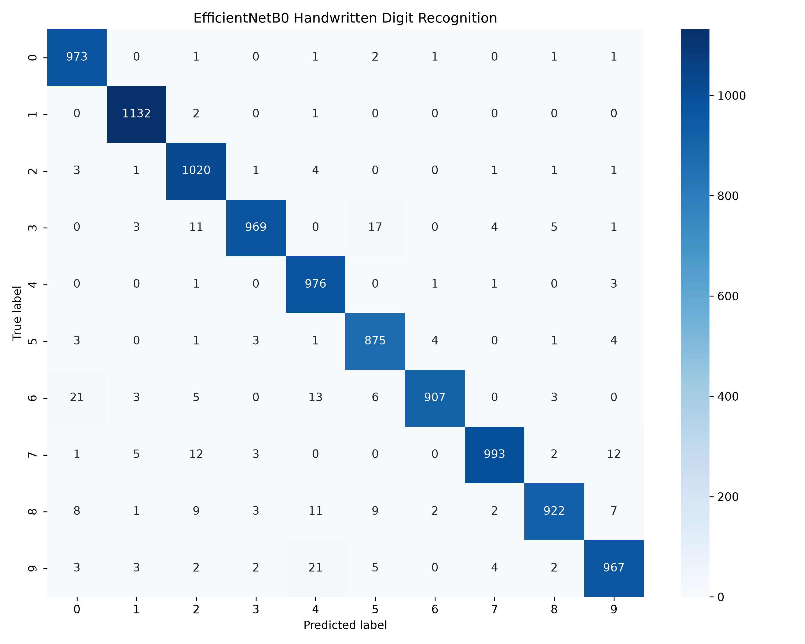

# Handwritten Digit Recognition Using Deep Learning

A deep-learning project that recognizes handwritten digits using CNN, ResNet, VGG, and EfficientNetB0, with an interactive application for digit prediction.

## Overview

This project explores handwritten digit recognition using four deep-learning architectures. The models are trained and evaluated on the MNIST dataset to compare their classification performance and model complexity.

The interactive application supports image uploads, mouse-based drawing, webcam-based air drawing, multi-digit recognition, and prediction confidence display.

## Key Features

- Handwritten digit classification from 0 to 9
- Comparison of CNN, ResNet-style, VGG-style, and EfficientNetB0 models
- Image upload and prediction
- Interactive mouse drawing
- Webcam-based air drawing
- Multi-digit recognition
- Prediction confidence display
- Accuracy and F1-score comparison graphs
- Confusion matrix visualizations

## Model Performance

| Model | Test Accuracy | Macro F1-Score | Parameters |
|---|---:|---:|---:|
| CNN | 99.02% | 0.9901 | 897,802 |
| ResNet | 99.05% | 0.9904 | 519,562 |
| VGG | 99.37% | 0.9936 | 435,306 |
| EfficientNetB0 | 97.34% | 0.9730 | 4,062,387 |

The custom VGG-style model achieved the highest test accuracy of **99.37%** on MNIST.

*Note: ResNet and VGG refer to custom architectures inspired by these model families, not the canonical ResNet-50 and VGG16 architectures.*

## Dataset

The project uses the MNIST handwritten digit dataset through TensorFlow/Keras.

- Training images: 60,000
- Test images: 10,000
- Classes: 10 digits (0–9)
- Image format: 28 × 28 grayscale pixels

## Technology Stack

- Python 3.12
- TensorFlow and Keras
- NumPy
- Matplotlib
- scikit-learn
- Gradio
- OpenCV
- MediaPipe
- Pillow

## Project Architecture



## Recognition Pipeline



## Digit Preprocessing



## Air Drawing State Machine



## Model Architectures



## Application Interface



## Installation

### 1. Clone the repository

```bash
git clone https://github.com/ankitCodeCraft/Handwritten-Digit-Recognition.git
cd Handwritten-Digit-Recognition
```

### 2. Create a virtual environment

```bash
python -m venv .venv
```

Activate it on Windows PowerShell:

```powershell
.\.venv\Scripts\Activate.ps1
```

### 3. Install dependencies

```bash
python -m pip install -r requirements.txt
```

### 4. Run the application

```bash
python src/app.py
```

Follow the local URL and instructions displayed in the terminal.

## Model Evaluation

To compare the saved models and generate performance graphs, run:

```bash
python src/compare_models.py
python src/plot_model_comparison.py
```

The comparison script generates a CSV file containing evaluation metrics. The plotting script saves accuracy and macro F1-score comparison graphs in `src/results/`.

## Results and Visualizations

### Accuracy Comparison



### Macro F1-Score Comparison



### VGG-Style Model Confusion Matrix


### EfficientNetB0 Confusion Matrix



The experiments show that the custom VGG-style model performs best among the four evaluated models on the MNIST test dataset. EfficientNetB0 has substantially more parameters but achieves lower test accuracy in this experimental setup.

These results are specific to MNIST and do not establish equivalent performance on real-world documents or other handwritten digit datasets.

## Limitations

- Evaluation is limited to the MNIST dataset.
- Predictions may be affected by handwriting style, image quality, and preprocessing.
- Prediction confidence does not guarantee that a classification is correct.
- Performance on external datasets has not been independently established.

## Future Scope

- Evaluate on additional handwritten digit datasets.
- Improve recognition of noisy and real-world document images.
- Explore Vision Transformers and multimodal approaches.
- Investigate model compression and inference optimization.

## Author

**Ankit Kumar Gupta**

B.Tech – Computer Science and Engineering (AI & ML)

## License

This repository is intended for educational and academic use. A license can be added if permission for public reuse, modification, and distribution is desired.